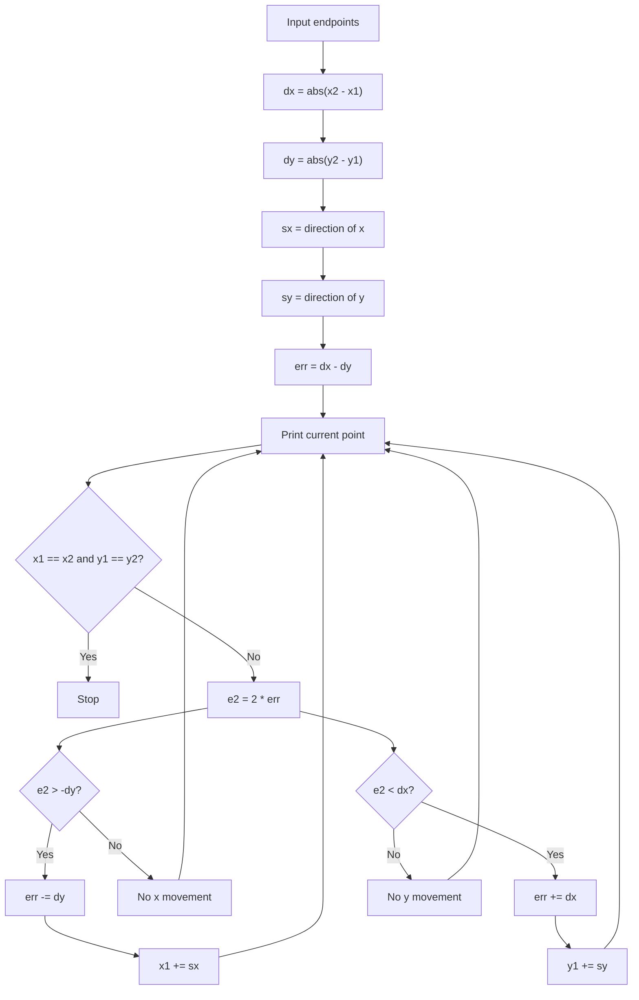

# Bresenham Line Drawing Algorithm

## 1. Introduction

Bresenham's line drawing algorithm is one of the most important techniques in computer graphics for drawing a straight line between two points on a raster display.

Unlike DDA, which uses floating-point increments, Bresenham uses only integer arithmetic. This makes it more efficient and more suitable for pixel-based graphics systems.

This program takes two endpoints and generates the intermediate points that approximate the line.

---

## 2. What is Bresenham algorithm?

Bresenham's algorithm works by deciding whether the next pixel should move in the x-direction, y-direction, or both. It does this using an error term called `err`.

The key idea is:

- calculate the horizontal and vertical distances,
- decide the step direction for x and y,
- update a decision variable to choose the next pixel.

This allows the line to be drawn using only integer values, which is faster and more accurate on screen grids.

---

## 3. Why is Bresenham important?

A screen is made of pixels, not continuous lines. So a mathematically perfect line must be approximated by a sequence of discrete pixel coordinates.

Bresenham's algorithm is widely used because it:

- avoids floating-point calculations,
- gives accurate line approximation,
- is efficient for graphics hardware and software,
- works well for many line slopes.

---

## 4. Code explanation

```python
def bresenham(x1, y1, x2, y2):
    dx = abs(x2 - x1)
    dy = abs(y2 - y1)

    if x1 < x2:
        sx = 1
    else:
        sx = -1

    if y1 < y2:
        sy = 1
    else:
        sy = -1

    err = dx - dy

    while True:
        print(f"({x1}, {y1})")

        if x1 == x2 and y1 == y2:
            break

        e2 = 2 * err

        if e2 > -dy:
            err -= dy
            x1 += sx

        if e2 < dx:
            err += dx
            y1 += sy
```
This function prints each pixel along the line from `(x1, y1)` to `(x2, y2)`.

---

## 5. Step-by-step analysis

### Step 1: Find the absolute differences

```python
dx = abs(x2 - x1)
dy = abs(y2 - y1)
```

These represent the total horizontal and vertical distance between the endpoints.

For example, if the start point is `(2, 3)` and the end point is `(8, 6)`, then:

```python
dx = abs(8 - 2) = 6
dy = abs(6 - 3) = 3
```

So the line moves 6 units in x and 3 units in y.

---

### Step 2: Determine direction of movement

```python
if x1 < x2:
    sx = 1
else:
    sx = -1

if y1 < y2:
    sy = 1
else:
    sy = -1
```

These values tell the algorithm in which direction to move:

- `sx = 1` means x increases
- `sx = -1` means x decreases
- `sy = 1` means y increases
- `sy = -1` means y decreases

This helps the algorithm move from the starting point toward the ending point.

The code uses `if...else` statements to set the direction explicitly rather than a compact conditional expression.

---

### Step 3: Initialize the error value

```python
err = dx - dy
```

This is the decision parameter. It helps determine whether the line should move horizontally, vertically, or both.

The algorithm keeps adjusting `err` as it moves from pixel to pixel.

---

### Step 4: Print the current point

```python
print(f"({x1}, {y1})")
```

Each loop iteration prints the current pixel coordinate.

---

### Step 5: Stop when the end point is reached

```python
if x1 == x2 and y1 == y2:
    break
```

When the current point becomes exactly the destination, the loop stops.

---

### Step 6: Update the decision parameter

```python
e2 = 2 * err
```

This doubles the current error so the algorithm can test whether it should move in x or y.

Then:

```python
if e2 > -dy:
    err -= dy
    x1 += sx
```

This condition decides whether to move horizontally.

And:

```python
if e2 < dx:
    err += dx
    y1 += sy
```

This condition decides whether to move vertically.

This is the heart of Bresenham's algorithm: it chooses the next pixel based on the error value, reducing the difference between the ideal line and the rasterized line.

---

## 6. Example walkthrough

Let us test the code:

```python
bresenham(2, 3, 8, 6)
```

### Initial values

```python
dx = abs(8 - 2) = 6
dy = abs(6 - 3) = 3
sx = 1
sy = 1
err = 6 - 3 = 3
```

Start from:

```python
(2, 3)
```

### Loop process

The algorithm prints the current point and updates step by step.

| Step | Current point | Error update | Next move |
|------|---------------|--------------|-----------|
| 1 | (2, 3) | err = 3 | move toward x and y |
| 2 | (3, 3) | err updates | continue |
| 3 | (4, 4) | err updates | continue |
| 4 | (5, 4) | err updates | continue |
| 5 | (6, 5) | err updates | continue |
| 6 | (7, 5) | err updates | continue |
| 7 | (8, 6) | end reached | stop |

### Output

```python
(2, 3)
(3, 3)
(4, 4)
(5, 4)
(6, 5)
(7, 5)
(8, 6)
```

This is the line that gets drawn from the start point to the end point.

---

## 7. Visual representation

A simple diagram for the path is:

```text
        y
        ^
        |
  6     •----------------------•
  5        •     •
  4           •
  3     •
      +-------------------------> x
         2  3  4  5  6  7  8
```

The generated points are:

```text
(2,3) -> (3,3) -> (4,4) -> (5,4) -> (6,5) -> (7,5) -> (8,6)
```

These points closely follow the straight line between the endpoints.

---

## 8. Flowchart of the algorithm



---

## 9. Key concepts

### a) Integer arithmetic

Bresenham uses integer math instead of floating-point math, which makes the algorithm fast and efficient.

### b) Decision parameter

The variable `err` decides which pixel should be chosen next. This is the main idea behind the algorithm.

### c) Rasterization

The line is converted from a continuous mathematical line into a set of pixel coordinates.

### d) Error correction

The algorithm keeps updating the error value so the line stays close to the ideal straight line.

---

## 10. Advantages of Bresenham algorithm

- fast because it uses integers,
- efficient for screen drawing,
- does not require division or floating-point operations,
- gives a good approximation of straight lines,
- widely used in graphics systems.

---

## 11. Limitations

- it is mainly designed for line drawing,
- it may not be as simple to understand as DDA at first,
- for highly complex graphics tasks, more advanced algorithms may be used.

---

## 12. Summary

Bresenham's line drawing algorithm is a classic and efficient way to draw a straight line on a pixel grid. It uses integer arithmetic and an error value to decide the next pixel position. Because it avoids floating-point calculations, it is more suitable for real-time graphics and low-level rendering systems.

In simple terms:

> Bresenham chooses each next pixel by checking whether the line is drifting too far from the ideal straight path.

---

## 13. Final code

```python
def bresenham(x1, y1, x2, y2):
    dx = abs(x2 - x1)
    dy = abs(y2 - y1)

    if x1 < x2:
        sx = 1
    else:
        sx = -1

    if y1 < y2:
        sy = 1
    else:
        sy = -1

    err = dx - dy

    while True:
        print(f"({x1}, {y1})")

        if x1 == x2 and y1 == y2:
            break

        e2 = 2 * err

        if e2 > -dy:
            err -= dy
            x1 += sx

        if e2 < dx:
            err += dx
            y1 += sy


# Example
bresenham(2, 3, 8, 6)
```

### Output

```python
(2, 3)
(3, 3)
(4, 4)
(5, 4)
(6, 5)
(7, 5)
(8, 6)
```

This output represents the sequence of pixels that approximate the straight line between the two points.
