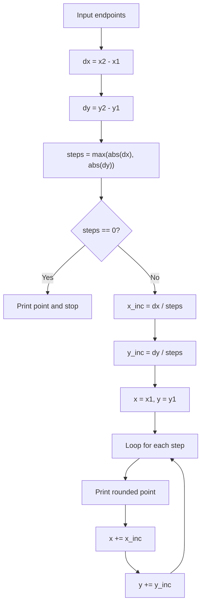

# DDA Line Drawing Algorithm

## 1. Introduction

The Digital Differential Analyzer (DDA) algorithm is a simple and efficient method used in computer graphics to draw a straight line between two points on a raster display.

This program takes two endpoints, calculates the horizontal and vertical differences, and then generates intermediate points along the line by using incremental steps.

The implementation file is:

```python
# dda.py
```

---

## 2. What is DDA?

DDA stands for Digital Differential Analyzer.

It works on the idea of:

- finding the difference between the starting point and ending point,
- computing how much the x and y values change per step,
- drawing intermediate points gradually until the end point is reached.

This is a common technique in line rasterization, where a geometric line is represented using discrete screen pixels.

---

## 3. Why do we need this algorithm?

A computer screen is made of pixels, not continuous lines. A line between two points must therefore be approximated using discrete points.

For example, if we want to draw a line from (2, 2) to (8, 5), the screen cannot show a perfectly smooth line. Instead, it must calculate many points between the endpoints and round them to the nearest pixel positions.

---

## 4. Core idea of the code

The given function is:

```python
def dda(x1, y1, x2, y2):
    dx = x2 - x1
    dy = y2 - y1

    steps = max(abs(dx), abs(dy))

    if steps == 0:
        print(f"({round(x1)}, {round(y1)})")
        return

    x_inc = dx / steps
    y_inc = dy / steps

    x, y = x1, y1

    for i in range(steps + 1):
        print(f"({round(x)}, {round(y)})")
        x += x_inc
        y += y_inc
```

This function prints all the intermediate pixel positions between the two given coordinates.

---

## 5. Step-by-step explanation of the code

### Step 1: Compute the differences

```python
dx = x2 - x1
dy = y2 - y1
```

Here:

- `dx` = change in x
- `dy` = change in y

For example, if the line goes from `(2, 2)` to `(8, 5)`, then:

```python
dx = 8 - 2 = 6
dy = 5 - 2 = 3
```

So the line moves 6 units in x and 3 units in y.

---

### Step 2: Find the number of steps

```python
steps = max(abs(dx), abs(dy))
```

This finds the maximum absolute change among x and y.

Why?

Because the line must be divided into the largest number of equal steps needed to cover either direction. This ensures we do not miss any pixel while drawing.

If:

- `dx = 6`
- `dy = 3`

then:

```python
steps = max(abs(6), abs(3)) = 6
```

So the line is broken into 6 equal parts.

---

### Step 3: Handle the special case of same point

```python
if steps == 0:
    print(f"({round(x1)}, {round(y1)})")
    return
```

If both endpoints are the same, then there is no line to draw. The function simply prints that point and stops.

Example:

```python
dda(4, 4, 4, 4)
```

Output:

```python
(4, 4)
```

---

### Step 4: Compute the increment per step

```python
x_inc = dx / steps
y_inc = dy / steps
```

These values tell how much x and y change at each step.

For the example `(2, 2)` to `(8, 5)`:

```python
x_inc = 6 / 6 = 1
y_inc = 3 / 6 = 0.5
```

This means:

- x increases by 1 each step
- y increases by 0.5 each step

So the line moves gradually from one point to the next.

---

### Step 5: Initialize the starting point

```python
x, y = x1, y1
```

The algorithm starts from the first coordinate and then moves forward step by step.

For `(2, 2)`, the line begins at:

```python
x = 2
y = 2
```

---

### Step 6: Draw each point in the loop

```python
for i in range(steps + 1):
    print(f"({round(x)}, {round(y)})")
    x += x_inc
    y += y_inc
```

This loop repeats for every step, including the initial point and final point.

At each iteration:

1. the current point is rounded and printed,
2. the x and y values are incremented by `x_inc` and `y_inc`.

Why `round()`?

Because pixel coordinates must be integer values. A value like `3.5` is rounded to `4` for display purposes.

Note: in Python, `round(4.5)` is `4` because Python uses bankers rounding (round half to even), so values exactly halfway between two integers are rounded to the nearest even number.

---

## 6. Example walkthrough

Let us test the code with:

```python
dda(2, 2, 8, 5)
```

### Compute values

```python
dx = 8 - 2 = 6
dy = 5 - 2 = 3
steps = max(abs(6), abs(3)) = 6
x_inc = 6 / 6 = 1
y_inc = 3 / 6 = 0.5
```

### Loop sequence

Starting values:

```python
x = 2
y = 2
```

The algorithm prints and updates like this:

| Step | x | y | Printed point |
|------|---|---|---------------|
| 0 | 2 | 2 | (2, 2) |
| 1 | 3 | 2.5 | (3, 2) |
| 2 | 4 | 3.0 | (4, 3) |
| 3 | 5 | 3.5 | (5, 4) |
| 4 | 6 | 4.0 | (6, 4) |
| 5 | 7 | 4.5 | (7, 4) |
| 6 | 8 | 5.0 | (8, 5) |

After rounding:

```python
(2, 2)
(3, 2)
(4, 3)
(5, 4)
(6, 4)
(7, 4)
(8, 5)
```

So the actual output is:

```python
(2, 2)
(3, 2)
(4, 3)
(5, 4)
(6, 4)
(7, 4)
(8, 5)
```

---

## 7. Visual interpretation

A simple diagram of the line is:

```text
        y
        ^
        |
  5     •   •
  4     •   •
  3     •
  2   •
      +-------------------> x
         2  3  4  5  6  7  8
```

The points generated by the algorithm approximate the line between `(2,2)` and `(8,5)`.

---

## 8. Flowchart of the algorithm



---

## 9. Important concepts

### a) Rasterization

Rasterization means converting a mathematical line into pixel-based points on a screen.

### b) Incremental calculation

Instead of solving the full line equation each time, DDA updates x and y progressively.

### c) Rounding

Because pixels are integer positions, `round()` is used to approximate the nearest pixel.

### d) Step size

The algorithm chooses the maximum change as the number of steps so that the line is sampled uniformly.

---

## 10. Advantages of DDA

- simple to understand and implement,
- works well for lines with moderate slopes,
- easy to extend for more complex drawing tasks,
- uses incremental calculations rather than heavy math.

---

## 11. Limitations of DDA

- may produce less accurate results for steep lines depending on rounding,
- not as efficient as more advanced algorithms for all graphics tasks,
- floating-point calculations may introduce small precision errors.

---

## 12. Summary

The DDA algorithm computes the difference between the start and end points, divides the line into steps, and moves gradually by a constant x and y increment. It is a classic method for line drawing in computer graphics and is widely used for understanding rasterization.

In simple words:

> DDA works by taking a line from point A to point B and sampling it step by step over the screen grid.

---

## 13. Final Python example

```python
def dda(x1, y1, x2, y2):
    dx = x2 - x1
    dy = y2 - y1

    steps = max(abs(dx), abs(dy))

    if steps == 0:
        print(f"({round(x1)}, {round(y1)})")
        return

    x_inc = dx / steps
    y_inc = dy / steps

    x, y = x1, y1

    for i in range(steps + 1):
        print(f"({round(x)}, {round(y)})")
        x += x_inc
        y += y_inc


# Example
dda(2, 2, 8, 5)
```

### Output

```python
(2, 2)
(3, 2)
(4, 3)
(5, 4)
(6, 4)
(7, 4)
(8, 5)
```

This output represents the points that approximate the straight line between the two given coordinates.
